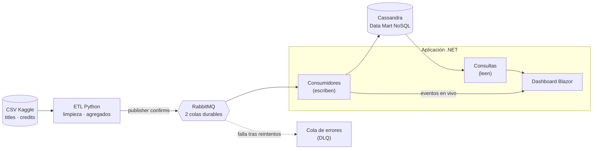
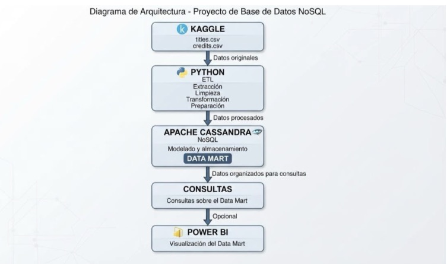

# Propuesta Técnica: Dashboard NoSQL del catálogo de Netflix

**Netflix Analytics** es una plataforma analítica sobre el catálogo público de Netflix (Kaggle). Tiene tres partes:
- **Python** limpia y transforma los datos;
- **RabbitMQ** transporta los datos de forma transaccional hasta un **Data Mart NoSQL en Apache Cassandra**;
- un backend **.NET** los sirve a un **dashboard Blazor** que se actualiza en tiempo real.

> La documentación técnica completa (propuesta, diseño, especificaciones, tareas y cronograma) está en [`openspec/changes/netflix-analytics-platform/`](openspec/changes/netflix-analytics-platform/).

## Cómo ejecutarlo

Requisitos: Docker con Compose, unos 2 GB de RAM libres y los puertos 8080, 5672, 15672 y 9042.

```bash
docker compose up -d --build           # Cassandra, esquema, RabbitMQ y la app
docker compose run --rm etl            # carga el catálogo
docker compose run --rm etl --rate 60  # carga lenta (~100 s), para la demo
docker compose down -v                 # reinicio total: borra los datos
```

- Dashboard: <http://localhost:8080> (si el puerto está ocupado: `APP_PORT=8081 docker compose up -d`).
- RabbitMQ: <http://localhost:15672> (usuario y contraseña `guest`).
- Si cambias el código del ETL, reconstruye su imagen: `docker compose --profile tools build etl`.

Pruebas:

```bash
pip install -r etl/requirements.txt && pytest etl/tests
docker compose up -d cassandra && dotnet test   # usan el keyspace aparte netflix_mart_test
```

Más detalle: [informe técnico](docs/INFORME.md) y [guion de demo](docs/GUION-DEMO.md).

| Resumen | Mensajería |
|---|---|
|  |  |
| **Detalle de título** | **Ranking** |
|  |  |
| **Personas** | |
|  | |

## 1. Definición del problema

Procesar y analizar volúmenes significativos de datos de fuentes heterogéneas, como catálogos y créditos de producciones, choca con límites de rendimiento y flexibilidad en los esquemas relacionales tradicionales. Las consultas que cruzan títulos con sus créditos y los agregan por género, año o país dependen de `JOIN` y `GROUP BY` costosos. Además, la carga de datos compite con las lecturas.

Se requiere una solución de almacenamiento NoSQL que optimice los tiempos de respuesta de lectura, con un **Data Mart orientado a consultas** para el análisis. La ingesta de datos debe ser **confiable y transaccional**.

## 2. Objetivo general

Diseñar e implementar una arquitectura de datos basada en **Apache Cassandra**, alimentada por un pipeline ETL en **Python** y una capa de mensajería transaccional con **RabbitMQ**, para procesar, modelar y explotar la información analítica de los datasets públicos de Kaggle mediante un backend **.NET** y un dashboard web interactivo.

## 3. Objetivos específicos

- Extraer, limpiar, transformar y preparar los datos de los archivos CSV con un pipeline automatizado en Python.
- Transportar los datos limpios mediante mensajería confiable con RabbitMQ: confirmación de publicación, reintentos, cola de errores (DLQ) y escrituras sin duplicados.
- Modelar el almacenamiento NoSQL en Apache Cassandra estrictamente a partir de los patrones de consulta requeridos.
- Construir un **Data Mart NoSQL orientado a consultas** con tablas desnormalizadas y agregados precalculados, sin JOINs en tiempo de lectura.
- Exponer las consultas analíticas desde una aplicación .NET que separa escritura (consumidores) y lectura (consultas).
- Visualizar los resultados en un dashboard Blazor. Este incluye una vista de **Mensajería** que hace visible el flujo transaccional.

## 4. Especificación y análisis de la fuente de datos

El pipeline procesa dos datasets relacionales de Kaggle (`archive/`) con los metadatos y el elenco de producciones audiovisuales.

### 4.1 Dataset principal: `titles.csv`

Guarda la información descriptiva y las métricas de cada título.

- **Volumen:** 6,137 registros (3,831 películas y 2,306 series, estrenadas entre 1945 y 2023).
- **Estructura:** 15 atributos.
- **Atributos clave:**
  - *Identificación y clasificación:* `id`, `title`, `type`, `release_year`, `age_certification`.
  - *Métricas y dimensiones:* `runtime`, `genres` (19 géneros), `production_countries` (107 países), `seasons`.
  - *Evaluaciones de calidad:* `imdb_score`, `imdb_votes`, `tmdb_popularity`, `tmdb_score`.
- **Retos de calidad:** las colecciones vienen serializadas como texto (`"['drama', 'sport']"`). Hay nulos en `imdb_score` (468) y `age_certification` (2,743). `seasons` solo aplica a series, y hay `runtime = 0` en 19 títulos.

### 4.2 Dataset relacional: `credits.csv`

Guarda el reparto y el equipo de producción de cada título.

- **Volumen:** 81,355 registros (76,570 actores y 4,785 directores) de 56,754 personas distintas.
- **Estructura:** 5 atributos: `person_id`, `id`, `name`, `character`, `role`.

### 4.3 Modelo de asociación en origen

Las tablas se relacionan uno a muchos (1:N) por `id`: un título de `titles.csv` tiene múltiples registros en `credits.csv`. No hay créditos huérfanos, y 5,788 títulos tienen créditos.

### 4.4 Del modelo relacional al Data Mart NoSQL

Cassandra no admite `JOIN` ni `GROUP BY` entre particiones, así que **no se usa un esquema estrella clásico**. El Data Mart tiene 9 tablas de dos tipos:
- **Tablas por consulta:** el título con su reparto embebido, los títulos por género y la filmografía por persona.
- **Agregados precalculados por el ETL:** KPIs, estrenos por año, totales por género y por país, rankings y top personas.

Cada gráfica del dashboard se resuelve leyendo **una sola partición**. El modelo completo está en el [diseño (D5)](openspec/changes/netflix-analytics-platform/design.md).

## 5. Stack tecnológico

| Componente | Rol en la arquitectura | Descripción |
|---|---|---|
| **Python** (pandas, pika) | Capa de procesamiento (ETL) | Extrae `titles.csv` y `credits.csv`, los limpia, calcula agregados y publica mensajes confirmados en RabbitMQ. |
| **RabbitMQ** + **MassTransit 8** | Capa de mensajería transaccional | Un exchange y dos colas durables, publisher confirms, reintentos y cola de errores (DLQ) automática. |
| **Apache Cassandra 5** | Capa de almacenamiento NoSQL | Data Mart orientado a consultas: tablas desnormalizadas con escrituras idempotentes (upsert por clave) y agregados precalculados. |
| **.NET 10** (una sola aplicación) | Capa de servicios | Los consumidores de RabbitMQ escriben en Cassandra y los servicios de consulta solo leen. |
| **Blazor Web App** (Interactive Server) + MudBlazor + ApexCharts | Capa de presentación | Dashboard oscuro estilo Netflix con 5 vistas, actualizado en tiempo real, incluida la vista **Mensajería**. |
| **Docker Compose** | Infraestructura local | Levanta Cassandra, RabbitMQ y la aplicación. El ETL se ejecuta con un comando. |

## 6. Arquitectura del flujo de datos

| Fase del flujo | Componente / herramienta | Descripción técnica de la etapa |
|---|---|---|
| 1. Origen de datos | Archivos CSV (Kaggle) | Ingesta de los archivos fuente `titles.csv` y `credits.csv`. |
| 2. Pipeline ETL | Python | Limpieza, validación, embebido del reparto y cálculo de agregados. |
| 3. Mensajería transaccional | RabbitMQ + MassTransit | Publicación confirmada, colas durables, reintentos y DLQ. |
| 4. Data Mart NoSQL | Apache Cassandra | Escritura idempotente en tablas orientadas a consultas y en tablas de agregados. |
| 5. Explotación | .NET + Blazor | Consultas por clave de partición y dashboard: Resumen, Catálogo, Ranking, Personas y Mensajería. |

## 7. Arquitectura propuesta



Solo hay **un camino de escritura**: Python → RabbitMQ → consumidor .NET → Cassandra. El dashboard solo lee de Cassandra. El diagrama detallado está en el [documento de diseño](openspec/changes/netflix-analytics-platform/design.md).

### 7.1 Visibilidad de la mensajería

La vista **Mensajería** muestra en tiempo real:
- un diagrama de colas con sus mensajes en espera;
- la tasa de mensajes por segundo;
- el progreso de la carga;
- un feed de eventos.

Tiene dos botones de demostración:
- **Inyectar corrupto:** el mensaje se reintenta y termina en la cola de errores.
- **Reenviar duplicado:** no se duplica nada, porque Cassandra hace upsert por clave.

Para demostrar la durabilidad basta con `docker compose stop app`: los mensajes se acumulan en la cola sin perderse y se procesan al volver a arrancar.

### 7.2 Diagrama original del curso



## 8. Integrantes

### Asignación de roles del equipo

- **Diana Paola Montes:** Líder de Datos NoSQL & Pipeline ETL (Cassandra, Docker y Python).
- **Jonathan Cervantes:** Ingeniero de Mensajería & Consumidores (RabbitMQ, MassTransit e Idempotencia).
- **Fernanda Baez:** Ingeniera de Backend .NET & APIs (ASP.NET Core y Cassandra).
- **Ximena Jasso:** Ingeniera de Frontend Blazor & UI/UX (Blazor Interactive Server, MudBlazor y Validación).

