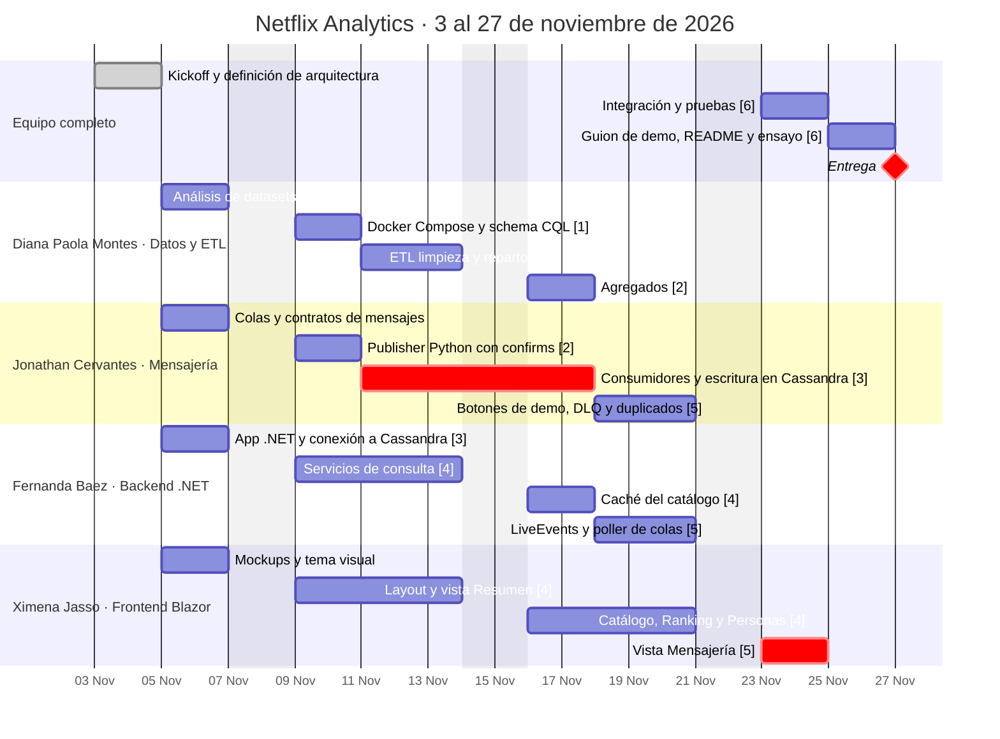

# Cronograma: Plataforma Netflix Analytics

- **Inicio:** martes 3 de noviembre de 2026
- **Entrega:** viernes 27 de noviembre de 2026
- **Jornadas:** días hábiles (lunes a viernes), 4 semanas

Las tareas detalladas de cada barra están en `tasks.md`; los números de grupo se indican entre corchetes.

## Diagrama de Gantt

## Hitos

| Fecha | Hito | Criterio de cumplimiento |
|---|---|---|
| 04-nov | Arquitectura definida | Change OpenSpec con propuesta, diseño, specs y tareas |
| 10-nov | Infraestructura lista | `docker compose up` con Cassandra y RabbitMQ healthy y esquema aplicado |
| 13-nov | Primer flujo de punta a punta | Un título viaja ETL → RabbitMQ → consumidor → Cassandra |
| 17-nov | Carga completa | Catálogo y agregados en Cassandra, sin duplicados al recargar |
| 20-nov | Vistas de datos listas | Resumen, Catálogo, Ranking y Personas funcionando |
| 24-nov | Dashboard completo | 5 vistas, incluida Mensajería con sus 2 botones de demo |
| 26-nov | Demo ensayada | Guion ≤ 10 min ejecutado sin fallas |
| 27-nov | **Entrega** | Repositorio, documentación y demo en vivo |

## Ruta crítica

**Consumidores y escritura en Cassandra → Vista Mensajería → Integración.** Sin consumidores no hay datos ni eventos, y la vista Mensajería es la pieza central de la demo. Por eso esas barras están marcadas como `crit`.
