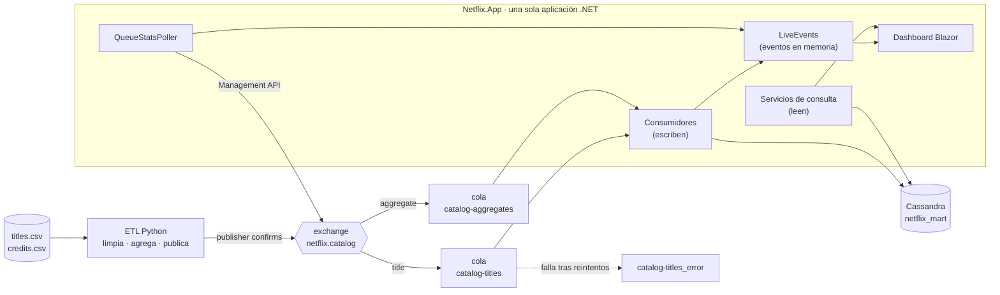

# Diseño: Plataforma Netflix Analytics

> Principio rector: **KISS**. Cada pieza existe porque la pide el curso o la demo. Cuando el framework ya resuelve algo (DLQ, reintentos, idempotencia por upsert, tiempo real de Blazor Server), se usa eso en lugar de construirlo.

## Context

La motivación está en `proposal.md`. Perfil real de los datos, medido sobre los CSV:

| Métrica | Valor |
|---|---|
| Títulos | 6,137: 3,831 `MOVIE` y 2,306 `SHOW`, sin ids duplicados. Años 1945–2023 |
| Géneros / países | 19 géneros (57 títulos sin género). 107 países (176 títulos sin país) |
| Nulos relevantes | `imdb_score` 468 · `imdb_votes` 484 · `age_certification` 2,743 · `runtime = 0` en 19 · `seasons` nulo en todas las películas |
| Créditos | 81,355: 76,570 actores y 4,785 directores. 56,754 personas. 0 huérfanos |

Restricciones: todo corre en un portátil con Docker Compose y se presenta en una demo en vivo.

## Goals / Non-Goals

**Goals:**
- Que cada pantalla se resuelva leyendo **una partición** de Cassandra, sin JOINs.
- Una ingesta que **se vea** transaccional: confirmación, cola de errores, sin duplicados ni pérdidas.
- Levantar todo con `docker compose up` y cargar los datos con un comando.

**Non-Goals:**
- API REST pública, autenticación, escalado multinodo y mapa geográfico.
- Mecanismos propios donde el framework ya da uno: registro de mensajes procesados, dispatcher CQRS o hub SignalR aparte.

## Arquitectura



Cómo encajan las piezas:
- **Solo los consumidores escriben** en Cassandra. El ETL publica y la UI lee. Esto es la separación lectura/escritura (CQRS ligero) **sin** interfaces genéricas ni dispatcher.
- **El tiempo real sale gratis de Blazor Server:** la UI ya está conectada por SignalR. Los consumidores avisan a un servicio singleton `LiveEvents` (un evento C#) y los componentes suscritos se redibujan con `StateHasChanged`. No hace falta un hub propio.
- La ingesta se lanza desde la terminal (`docker compose run --rm etl`), lo que también es visible en la demo.

### Estructura del repositorio

```
docker-compose.yml
cassandra/schema.cql
etl/
  extract.py  transform.py  aggregate.py  publish.py  main.py
  tests/                       pytest de transform y aggregate
  Dockerfile  requirements.txt
src/Netflix.App/
  Data/        CassandraSession, TitleWriter (escritura), DashboardQueries (lectura)
  Messaging/   mensajes, TitleConsumer, AggregateConsumer, FaultConsumer, QueueStatsPoller, DemoPublisher
  Live/        LiveEvents
  Components/  Layout y Pages (Resumen, Catalogo, Ranking, Personas, Mensajeria)
tests/Netflix.App.Tests/       xUnit: consumidores con el test harness de MassTransit
```

## Decisions

### D1. RabbitMQ en lugar de Kafka
RabbitMQ tiene ack por mensaje, DLQ nativa y una UI de administración lista para enseñar. Kafka es un log de streaming, más pesado y sin DLQ incluida.

### D2. MassTransit 8.x
Da gratis los reintentos, la cola `_error` automática y el test harness. Se fija la 8.x porque la v9 tiene licencia comercial.

### D3. Colas y mensajes

| Elemento | Detalle |
|---|---|
| Exchange `netflix.catalog` | topic, durable |
| Cola `catalog-titles` | durable, routing key `title` → `TitleConsumer` |
| Cola `catalog-aggregates` | durable, routing key `aggregate` → `AggregateConsumer` |
| Colas `_error` | Las crea MassTransit cuando un mensaje agota sus reintentos |
| Reintentos | `UseMessageRetry(r => r.Interval(3, TimeSpan.FromSeconds(1)))` |

Python publica **JSON plano** con pika:
- `confirm_delivery()` y mensajes persistentes (`delivery_mode=2`);
- cada mensaje confirmado por el broker; si alguno no se confirma, el ETL termina con error.

En .NET, cada cola usa `UseRawJsonDeserializer()`, `ConfigureConsumeTopology = false` y un binding a su routing key.

```jsonc
// routing key "title"
{ "id": "tm82169", "title": "Rocky", "type": "MOVIE", "description": "…",
  "release_year": 1976, "age_certification": "PG", "runtime": 119, "seasons": null,
  "genres": ["drama","sport"], "production_countries": ["US"],
  "imdb_score": 8.1, "imdb_votes": 588100, "tmdb_popularity": 106.361, "tmdb_score": 7.782,
  "credits": [ { "person_id": 3180, "name": "Sylvester Stallone", "character": "Robert \"Rocky\" Balboa", "role": "ACTOR" } ],
  "position": 2, "total_titles": 6137 }   // position / total_titles = barra de progreso
// routing key "aggregate"
{ "kind": "by_genre", "rows": [ { "genre": "drama", "total": 3120, "movies": 2001, "shows": 1119, "avg_imdb": 6.7 } ] }
```

### D4. Idempotencia por upsert (sin tabla de control)
En Cassandra todo `INSERT` es un upsert: escribir dos veces el mismo título con la misma clave deja **una sola fila**. Por eso un mensaje repetido o reintentado nunca duplica datos.

Para que el feed muestre "duplicado", el consumidor lee primero `SELECT id FROM titles_by_id WHERE id = ?`, una lectura por clave muy barata. Si el id ya existe, el evento sale como *actualizado (ya existía)*; si no, como *nuevo*.
*Alternativa descartada:* una tabla `processed_messages` con LWT. Añade latencia y lógica de reversión sin aportar nada en este caso.

### D5. Data Mart NoSQL orientado a consultas
Cassandra no hace JOINs ni `GROUP BY` entre particiones, así que hay **una tabla por pantalla** y los agregados los calcula el ETL. El keyspace es `netflix_mart` (`SimpleStrategy`, RF=1).

| Tabla | Clave primaria | Pantalla |
|---|---|---|
| `titles_by_id` (reparto embebido como `list<frozen<credit>>`) | `(id)` | Detalle de título y carga del catálogo |
| `titles_by_genre` | `((genre), imdb_score, id)`, `imdb_score DESC` | Resumen → clic en un género |
| `credits_by_person` | `((person_id), release_year, title_id, role)`, `release_year DESC` | Personas → filmografía |
| `kpis` | `(name)` | Tarjetas KPI |
| `agg_by_year` | `((type), release_year)` | Gráfica de estrenos por año |
| `agg_by_genre` | `((scope), genre)` | Barras de géneros |
| `agg_by_country` | `((scope), country)` | Barras de top países |
| `ranking` | `((list_name), position)`. `list_name` ∈ `imdb_all`, `imdb_movie`, `imdb_show`, `popularity_all`, `popularity_movie`, `popularity_show` | Ranking (top 50) |
| `top_people` | `((role), position)` | Personas (top 50 por rol) |

En `titles_by_genre`, los títulos sin `imdb_score` se guardan con `-1` para que queden al final.

### D6. Escritura del `TitleConsumer`
1. Valida el mensaje: `id`, `type` y `release_year` presentes y con formato correcto. Si no, lanza una excepción; tras 3 reintentos, MassTransit lo mueve a `catalog-titles_error`.
2. Comprueba si el título ya existe (D4).
3. Hace upsert en `titles_by_id`, `titles_by_genre` (una fila por género) y `credits_by_person` (una fila por crédito), con sentencias preparadas.
4. Publica en `LiveEvents` un evento con id, título, estado (nuevo/actualizado) y milisegundos.

`AggregateConsumer` hace upsert de las filas del agregado recibido. `FaultConsumer` escucha `Fault<TitleMessage>` y publica en `LiveEvents` un evento de error con el motivo.

### D7. Agregados calculados en el ETL
pandas tiene todo el dataset en memoria, así que un `groupby` es trivial y exacto. Cada agregado viaja como un mensaje y se aplica con upsert, que es idempotente.

### D8. Lectura y catálogo
`DashboardQueries` tiene un método por gráfica, y cada uno lee una partición.

El **Catálogo** carga `titles_by_id` completo una sola vez (~6k filas), lo guarda en memoria y filtra ahí: texto, tipo y género. La caché se refresca cuando llega el agregado `kpis`, que es el último que publica cada corrida. Como `kpis` viaja por otra cola y puede procesarse antes que los títulos pendientes, la caché solo se conserva si ya tiene tantos títulos como indica el KPI; si no, se vuelve a leer la próxima vez.
*Alternativa descartada:* índices secundarios (SAI), que no aportan nada a este volumen.

### D9. Vista Mensajería
- **Diagrama sencillo** (cajas de MudBlazor): ETL → exchange → cola de títulos / cola de agregados / cola de errores → app → Cassandra. Cada cola muestra **mensajes en espera y consumidores**, con números que se actualizan.
- **Gráfica** de mensajes por segundo (publicados y entregados) de los últimos 60 s.
- **Barra de progreso** de la corrida (`position` / `total_titles` del último título procesado; así sobrevive a un reinicio de la app y empieza de cero en cada corrida) y **feed** de los últimos 100 eventos: nuevo, actualizado o error.
- Un `QueueStatsPoller` (BackgroundService) consulta cada 2 s `GET /api/queues` de la **Management API** de RabbitMQ y lo publica en `LiveEvents`.
- **Dos botones de demo** (`DemoPublisher`):
  - **Inyectar corrupto:** publica a la cola de títulos un JSON sin `id`. Se ven los reintentos fallar, el mensaje llega a `catalog-titles_error` y el contador de errores sube.
  - **Reenviar duplicado:** republica el último título recibido. El feed lo muestra como "actualizado (ya existía)" y el KPI de títulos no cambia.
- **Pausar el consumidor**, sin código: `docker compose stop app` → en la UI de RabbitMQ (`:15672`) se ve crecer la cola. Con `docker compose start app`, la cola se vacía.

### D10. Frontend: Blazor Interactive Server + MudBlazor + ApexCharts
Es el mismo lenguaje del backend, los servicios se inyectan por DI y el tiempo real ya viene incluido. MudBlazor da el layout, las tablas y el tema oscuro; ApexCharts da área, barras y líneas.

Tema: fondo `#141414`, superficie `#1F1F1F`, acento y películas `#E50914`, series `#F5C518`, OK `#46D369`, error `#FF5252`, fuente Inter.

### D11. Docker Compose

| Servicio | Imagen | Notas |
|---|---|---|
| `cassandra` | `cassandra:5.0` | `MAX_HEAP_SIZE=1G`, con healthcheck |
| `cassandra-init` | `cassandra:5.0` | Ejecuta `cqlsh -f schema.cql` y termina |
| `rabbitmq` | `rabbitmq:4-management` | Puertos 5672/15672, con healthcheck |
| `app` | build `src/Netflix.App` | Puerto 8080. Arranca cuando Cassandra y RabbitMQ están listos |
| `etl` | build `etl/` | `profiles: [tools]`: solo corre con `docker compose run --rm etl` |

Cada servicio tiene un límite de `cpus` (Cassandra 1.0; los demás 0.5) para que un portátil de 2 CPU no se sature, y Cassandra un `start_period` de 90 s. El puerto de la app se puede cambiar con `APP_PORT` (8080 por defecto).

### D12. Reglas de limpieza del ETL

| Campo | Regla |
|---|---|
| `genres`, `production_countries` | `ast.literal_eval` → lista sin duplicados. Géneros en minúsculas, países en mayúsculas |
| Puntuaciones | Vacío o fuera de 0–10 → nulo |
| `imdb_votes` | float → int |
| `age_certification` | Vacío → `NR` |
| `runtime` | `0` → nulo |
| `seasons` | Nulo en películas |
| Texto | `strip()`. Descripción vacía → `""` |
| Créditos | `character` vacío → nulo |
| Ranking IMDb | Solo títulos con ≥ 1,000 votos |
| Validación | id `tm…/ts…`, tipo `MOVIE/SHOW`, año 1900–2030. Las filas inválidas se omiten y se cuentan en el resumen de consola |

### D13. Mockups

```
┌────────────┬──────────────────────────────────────────────────────────┐
│ N ANALYTICS│ Resumen                                                    │
│ ▣ Resumen  │ ┌───────┐┌────────┐┌───────┐┌────────┐┌────────┐           │
│ ▤ Catálogo │ │ 6,137 ││ 3,831  ││ 2,306 ││  6.5   ││ 56,754 │           │
│ ★ Ranking  │ │Títulos││Películas││Series ││IMDb avg││Personas│           │
│ ☺ Personas │ └───────┘└────────┘└───────┘└────────┘└────────┘           │
│ ⇄ Mensajería│ ┌─────────────────────────────┐┌───────────────────────┐  │
│            │ │ Estrenos por año (área)     ││ Top géneros (barras)   │  │
│            │ └─────────────────────────────┘└───────────────────────┘  │
│            │ ┌─────────────────────────────┐┌───────────────────────┐  │
│            │ │ Top 10 países (barras)      ││ Películas vs Series    │  │
│            │ └─────────────────────────────┘└───────────────────────┘  │
└────────────┴──────────────────────────────────────────────────────────┘

┌ Mensajería ─────────────────────────────────────────────────────────┐
│ [ETL] → (netflix.catalog) → [catalog-titles     ready 1,204 · 1 cons]│
│                           → [catalog-aggregates ready 0     · 1 cons]│
│                           ↘ [catalog-titles_error  3 ⚠]              │
│                  → [Netflix.App] → (Cassandra)                       │
├────────────────────────────┬────────────────────────────────────────┤
│ Mensajes/s  ▁▃▆█▇▅          │ 12:01:03 tm82169 Rocky      ✔ nuevo 4ms │
│ Progreso   ████████░░ 82%   │ 12:01:04 tm82169 Rocky      ↺ ya existía│
│                             │ 12:01:05 (sin id)           ✖ error     │
├────────────────────────────┴────────────────────────────────────────┤
│ [☠ Inyectar corrupto]  [⧉ Reenviar duplicado]   Abrir RabbitMQ ↗     │
└──────────────────────────────────────────────────────────────────────┘
```
- **Catálogo:** tabla con búsqueda y filtros de tipo y género. Al hacer clic se abre un panel con sinopsis, métricas y reparto.
- **Ranking:** pestañas IMDb / Popularidad, con chips Todos / Películas / Series.
- **Personas:** pestañas Actores / Directores con el top 50; al hacer clic se ve la filmografía.

## Risks / Trade-offs

- **[Arranque lento de Cassandra, ~60 s]** → healthcheck y `depends_on: condition: service_healthy`.
- **[Si un título cambia de puntuación entre corridas, queda una fila vieja en `titles_by_genre`]** → los datos son estáticos. Si hiciera falta, `docker compose down -v` y recargar.
- **[El feed puede saturarse con 6k eventos]** → el feed guarda solo los últimos 100 y la UI se refresca como máximo 4 veces por segundo.
- **[La UI de RabbitMQ actualiza tasas cada 5 s por defecto]** → `collect_statistics_interval = 1000` en `rabbitmq.conf`.

## Migration Plan

1. `docker compose up -d --build`
2. `docker compose run --rm etl` (con `--rate 60` para que la demo se vea fluir)
3. Abrir `http://localhost:8080`

Para reiniciar desde cero: `docker compose down -v`.
